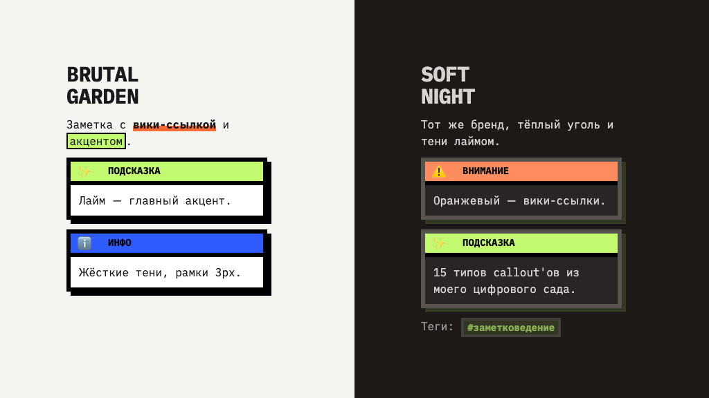
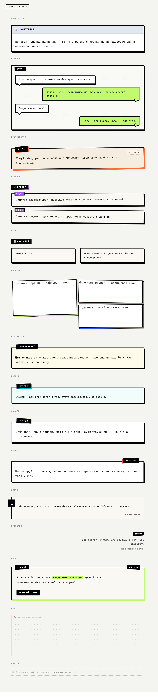
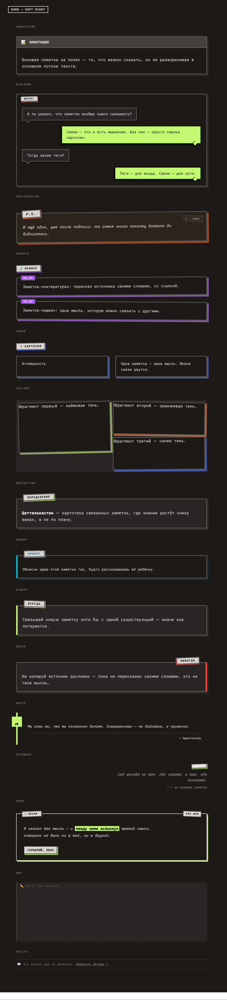

# BrutalGarden

A neo-brutalist Obsidian theme ported from my digital garden at
**[rustamagamaliev.ru](https://rustamagamaliev.ru)** — paper, hard shadows, black
3px borders, and a full system of 17 hand-designed callouts.

Two faces, switched by Obsidian's own light/dark toggle:

- **Light — «paper».** `#F4F4F0`, black borders, shadows cut like cardboard
  (`6px 6px 0`, zero blur), a 24px dot grid on the chrome.
- **Dark — «Soft Night».** Warm charcoal `#1C1917`, borders `#57534E`, and the
  signature move: shadows tinted **lime** instead of black.

Accents follow the house palette — **Neo-Lime** `#C2F970` leads, **Neo-Blue**
`#2E5CFF` adds depth, **Neo-Orange** `#FF6B35` marks attention and wiki-links.

---

## 🎨 17 callouts, not repainted rectangles

This is the part I actually care about. The callouts aren't recolored boxes —
each type has its own character, ported from the live CSS of my garden:

| | |
|---|---|
| `quote` | book page — black bar, quote mark hanging in the margin |
| `question` | exam ticket — blue stub with «?», the topic set along the spine, perforation with V-notches |
| `epigraph` | a whisper in the margin, right-aligned, sticker title |
| `poem` | concert poster — silkscreen, «33⅓ RPM», signature stamp |
| `definition` | dark paper, lime sticker |
| `example` | numbered specimen cards (`EX_01`, `EX_02`…) |
| `dialogue` | alternating chat bubbles |
| `collage` | rotated cards with lime / orange / blue shadows |
| `postscriptum` | a postal card with a stamp |
| `always` / `never` | green stamp left / red stamp right |
| `prompt` | terminal card for AI prompts |
| `gap` | dot-grid writing area — room to think |
| `notify` | a quiet dashed banner, no background |
| `annotation` | a side note that doesn't derail the text |
| `cards` | flip-card layout |
| `snail` | a logical chain as an engineering drawing — grid paper, dark title-block stamp with a spiral |

Standard Obsidian callouts (`info`, `tip`, `warning`, `success`, `bug`…) all
work too — they inherit the same brutal frame and title bar.

Same in Soft Night →

**Honest limitations.** `cards` doesn't flip and `prompt` has no copy button:
on the website that DOM is built by JavaScript, and a theme is CSS only. Their
graphics are intact; only the interaction is missing. Same story for `snail`:
on the site its body becomes an IF ═▶ THEN + BECAUSE diagram built from the
text, here the drawing frame and stamp are in place but the body stays plain
text. `[!YT]` isn't styled at all — on the site it's a retro TV assembled by
JavaScript, so here it stays a regular callout with the title and the link.

---

## ✍️ Typography

The theme sets **iA Writer** as its font stack — Duo S for text, Quattro S for
the interface, Mono S for code. Duo S is a duospaced face: it keeps the
monospace texture of the original site (IBM Plex Mono) but reads easier on long
essays.

Two things worth knowing:

1. **Your font settings win over the theme.** Obsidian resolves fonts as
   `--font-text: var(--font-text-override), var(--font-text-theme), …` — the
   *override* is your setting in **Appearance**, and it comes first. Leave the
   font fields **empty** for the theme's fonts to apply.
2. **iA Writer tops out at Bold 700** — there is no 900 in any of its cuts. The
   giant headline of the site is `font-weight: 900`, so here the density is
   rebuilt from size, uppercase, and tight tracking instead. If you prefer your
   own fonts, just set them in Appearance — everything else holds.

The fonts are **not bundled**. Grab them free from
[iaolo/iA-Fonts](https://github.com/iaolo/iA-Fonts) (install the *Static* cuts —
Regular, Italic, Bold, BoldItalic). Without them the theme falls back to your
system monospace, which is fine but not the intended texture.

> [!note] A bug you may hit
> iA's `iAWriterQuattroS-Bold.ttf` ships with `usWeightClass: 400` while its
> style bits say Bold. macOS forgives this; Chromium — which Obsidian runs on —
> does not, and synthesizes a smeared fake bold instead. If your bold looks
> mushy, patch the metadata to `700`.

---

## 📦 Install

**Manually.** Download `manifest.json` and `theme.css` from the
[latest release](../../releases/latest), drop them into
`YourVault/.obsidian/themes/BrutalGarden/`, then pick **BrutalGarden** in
**Settings → Appearance → Themes**. The folder name must match exactly.

**Via [BRAT](https://github.com/TfTHacker/obsidian42-brat).** Add this repo as a
beta theme.

---

## 🔧 How it's built

The theme is **variable-first**, the way Obsidian's docs recommend: it overrides
the `--color-base-00…100` scale and the semantic tokens, so plugins that read
the same variables — Canvas, the graph, Excalidraw, Kanban — get repainted for
free. On top of that sits a thin layer of selectors carrying the brutal
signature: 3px borders, zero-blur shadows, the dot grid, uppercase headings.

The callout layer is **generated, not hand-copied.** A transpiler reads the live
CSS of the website and rewrites it for Obsidian's markup
(`.callout-<type>` → `[data-callout]`, `.callout-body` → `.callout-content`,
`.theme-soft-night` → `.theme-dark`). That's why the theme can't drift from the
site: the site stays the source of truth.

Everything below the `PORTED CALLOUTS` marker in `theme.css` is generated —
don't edit it by hand.

---

## 🇷🇺 По-русски

**BrutalGarden** — это мой [цифровой сад](https://rustamagamaliev.ru), перенесённый
в Обсидиан. Нео-брутализм: бумага `#F4F4F0`, чёрные рамки 3px, тени без размытия
— как вырезанный картон. Ночью — «Soft Night»: тёплый уголь и тени лаймом.

Главное в теме — **система из 17 callout'ов**. Не перекрашенные прямоугольники,
а разные характеры: цитата как страница книги, эпиграф-шёпот на полях, стихи как
концертная афиша, вопрос как экзаменационный билет с отрывным корешком,
«пауза» с точечной сеткой, чтобы было где подумать.

Шрифты — iA Writer (ставятся [отдельно](https://github.com/iaolo/iA-Fonts),
бесплатно). Чтобы тема ими управляла, поля шрифтов в настройках внешнего вида
надо **очистить** — ваши настройки всегда бьют тему.

---

## License

[MIT](LICENSE) © Rustam Agamaliev

Use it, fork it, repaint it. If you build something on top — I'd love to see it.
